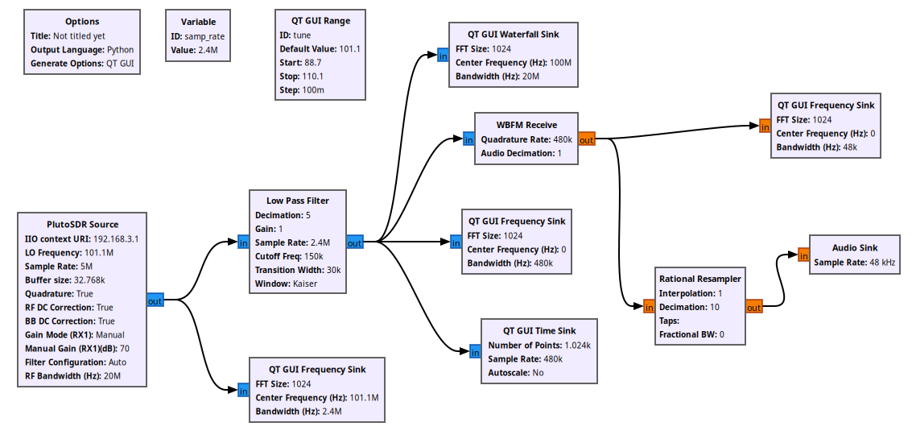
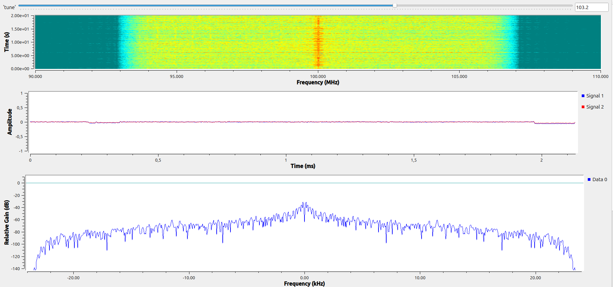
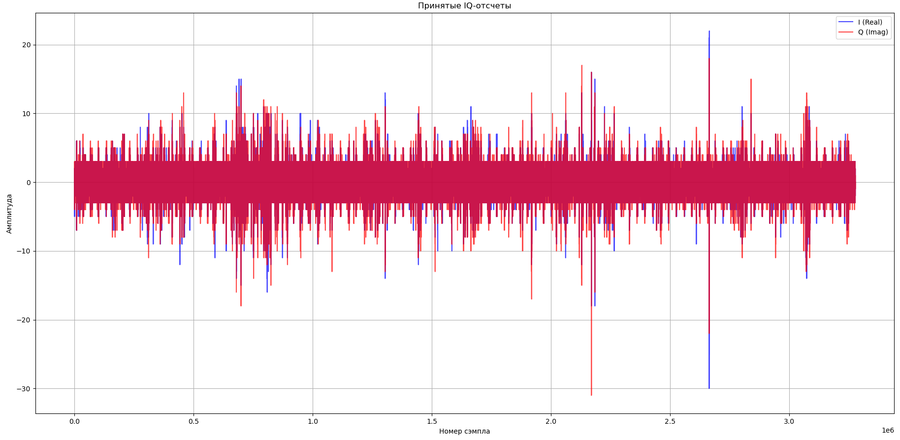
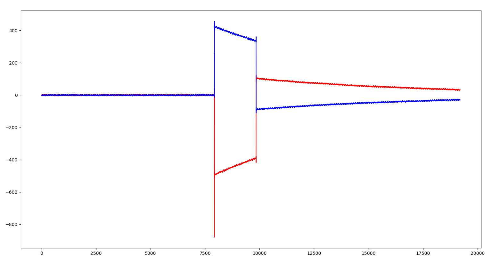

# Практика 1, 2: Архитектура Adalm Pluto SDR. GNU Radio. Построение радио-приёмника

## Цель работы
Изучение архитектуры программно-определяемой радиосистемы (SDR) Adalm Pluto и создание работающего FM-радиоприёмника в GNU Radio Companion.

## Описание схемы
На рисунке 1 представлена схема приёмника в GNU Radio. Сигнал с PlutoSDR (частота дискретизации 2.4 МГц, центральная частота 101.1 МГц) проходит через фильтр низких частот, затем демодулируется блоком WBFM Receive. Для визуализации используются спектральный анализатор (QT GUI Frequency Sink), водопад (QT GUI Waterfall Sink) и временная диаграмма (QT GUI Time Sink). После ресемплинга сигнал выводится на аудиоустройство.

## Результат
В ходе работы был успешно настроен приём FM-радиостанции **Европа Плюс** на частоте **103.2 МГц**. Сигнал был принят с хорошим качеством.

## Основные параметры
- **Sample Rate:** 2.4 MHz
- **LO Frequency:** 101.1 MHz  
- **Buffer Size:** 32.768k
- **RF Bandwidth:** 20 MHz
- **Gain Mode:** Manual (70 dB)

*Рисунок 1 - Схема FM-приёмника в GNU Radio Companion*

*Рисунок 2 - Waterfall, Amplitude, Relative Gain радиостанции Европа Плюс 103.2 МГц*

---

# Практика 3: Знакомство с библиотеками SoapySDR. Инициализация SDR-устройства и получение цифровых IQ-отсчетов

## Цель работы
Освоить базовый API библиотеки SoapySDR для работы с Adalm Pluto SDR на языке C++. Научиться инициализировать устройство, настраивать параметры радиоканала и программно получать сырые цифровые IQ-отсчеты в буфер с последующим сохранением в бинарный файл.

## Описание реализации
Для взаимодействия с устройством использовался C++ и библиотека `SoapySDR`. Алгоритм работы программы включал следующие шаги:
1. Инициализация устройства через `SoapySDRDevice_make` с указанием драйвера `plutosdr` и интерфейса `usb:`.
2. Настройка параметров приёмника: частота дискретизации (Sample Rate) = 1 МГц, несущая частота (LO Frequency) = 800 МГц, коэффициент усиления (Gain) = 40 дБ.
3. Создание и активация потока приёма (`setupStream`, `activateStream`) с форматом данных `SOAPY_SDR_CS16` (чередующиеся 16-битные значения I и Q).
4. Циклическое чтение данных из устройства функцией `SoapySDRDevice_readStream` в буфер типа `int16_t`.
5. Побайтовая запись полученных данных в бинарный файл `rxdata.pcm` для последующего анализа.

## Результат
Программа успешно подключилась к PlutoSDR, настроила радиотракт и записала массив сырых IQ-данных. Для проверки корректности данных был написан скрипт на Python (с использованием `numpy` и `matplotlib`), который прочитал бинарный файл и построил временные диаграммы I-компоненты (Real, синяя) и Q-компоненты (Imag, красная), что подтвердило корректность получения и сохранения отсчетов.

## Основные параметры кода
- **Sample Rate:** 1 MHz
- **LO Frequency:** 800 MHz
- **Format:** CS16 (Complex Signed 16-bit)
- **Gain:** 40 dB (Manual)
- **Количество итераций:** 100

*Рисунок 3 - Временные диаграммы I и Q компонент принятого сигнала (шум эфира)*

# Практика 4: Adalm Pluto SDR & Timestamp. Одновременный прием и передача с синхронизацией по времени

## Цель работы
Изучить архитектуру Adalm Pluto SDR, понять ограничения пропускной способности USB 2.0 при полнодуплексной работе.

## Описание реализации
Для работы использовалась модифицированная версия драйвера SoapyPlutoSDR с поддержкой timestamping. Алгоритм работы программы включает следующие ключевые этапы:

1. **Инициализация с поддержкой временных меток**: При создании устройства передаются специальные аргументы, включая `timestamp_every=1920`.
2. **Настройка радиотракта**: Частота дискретизации 1 МГц, несущая частота 800 МГц. Усиление приемника установлено на 30.0 дБ, передатчика на -40.0 дБ (для предотвращения перегрузки при loopback-тесте).
3. **Формирование TX-буфера**: 
   - Основная часть буфера заполняется тестовым сигналом с постоянной амплитудой (I=2000, Q=2000).
   - В начало буфера внедряется служебный паттерн: флаги `0xFFFF`, за которыми следует 64-битная временная метка (`tx_time`), разбитая на 8 байт. Каждый байт сдвигается на 4 бита влево (`<< 4`), чтобы корректно выровняться в младших значащих битах (LSB) 12-битного ЦАП AD9363.
4. **Синхронизированный цикл RX/TX**:
   - Считывается блок данных RX с получением точного времени прибытия `timeNs`.
   - Рассчитывается время будущей передачи: `tx_time = timeNs + 4 мс`.
   - На заданной итерации (в примере `buffers_read == 2`) буфер отправляется в эфир с флагом `SOAPY_SDR_HAS_TIME` и рассчитанным `tx_time`. Это гарантирует, что ПЛИС начнет передачу строго в заданный наносекундный интервал, независимо от задержек шины USB или планировщика ОС.
5. **Сохранение данных**: Принятые IQ-отсчеты (формат CS16) записываются в бинарный файл `.pcm` для последующего анализа.

## Результат
Успешно реализован режим одновременного приема и передачи на одном устройстве Adalm Pluto SDR с использованием аппаратной синхронизации по времени. Внедрение временных меток позволило компенсировать джиттер и задержки USB-интерфейса, обеспечив точное и предсказуемое время начала передачи тестового сигнала. Полученные данные корректно сохраняются и могут быть визуализированы.

## Основные параметры
- **Sample Rate:** 1 MHz
- **LO Frequency:** 800 MHz
- **Format:** CS16 (Complex Signed 16-bit)
- **RX Gain:** 30.0 dB
- **TX Gain:** -40.0 dB
- **Особенность:** Включена генерация timestamp (`timestamp_every=1920`) и отправка по флагу `SOAPY_SDR_HAS_TIME`.

*Рисунок — Визуализация принятых IQ-отсчетов, демонстрирующая успешный прием синхронизированного тестового сигнала*

---